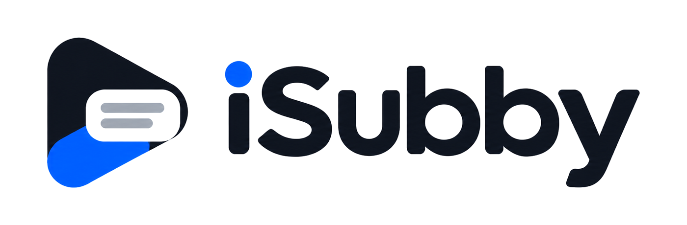

<p align="center">
  
</p>

<p align="center">
  성균관대학교 iCampus(아캠) 강의 영상 위에 자막을 띄워주는 크롬 확장프로그램
</p>

---

## 소개

**iSubby**는 학습용으로 만든 SRT 자막을 iCampus 강의 플레이어 위에 겹쳐 보여줍니다. 관리자가 올린 공유 자막은 수강생이 강의를 열기만 하면 자동으로 표시됩니다.

이름은 iCampus의 **i**와 subtitle을 귀엽게 부른 **Subby**를 합친 것입니다.

## 주요 기능

- **자막 오버레이**: iCampus 강의 플레이어 위에 SRT/VTT 자막을 표시
- **재생 위치 동기화**: 영상의 현재 재생 위치를 매 프레임 읽어 자막을 맞추므로, 배속 재생이나 앞뒤 이동에도 항상 싱크가 맞음
- **공유 자막 자동 적용**: 관리자가 저장소에 올린 자막을 강의를 열 때 자동으로 불러옴
- **강의별 저장**: 직접 불러온 자막은 강의(콘텐츠 ID)별로 저장되어 다음에 다시 열면 자동 적용
- **싱크 미세 조절**: 자막 전체를 ±0.1초 / ±1초 단위로 앞당기거나 늦춤
- **표시 설정**: 글자 크기, 아래 여백, 배경 진하기, 자막 켜기/끄기
- **전체화면 지원**: 플레이어 전체화면에서도 자막 유지
- **인코딩 자동 판별**: UTF-8과 EUC-KR(CP949) SRT 모두 읽음

---

## 설치

1. 이 저장소를 내려받아 압축을 풉니다. (**Code → Download ZIP**)
2. 크롬 주소창에 `chrome://extensions` 입력
3. 우측 상단 **개발자 모드** 켜기
4. **압축해제된 확장 프로그램 로드** → 압축을 푼 폴더 선택

Edge, 네이버 웨일, Brave, Arc 등 크로미움 기반 브라우저에서도 같은 방법으로 설치할 수 있습니다.

---

## 사용법

### 공유 자막 보기
강의 페이지를 열기만 하면 됩니다. 공유 자막이 있는 강의라면 플레이어 오른쪽 위에 `공유 자막 N개 적용됨`이 잠깐 표시되고 자막이 나타납니다.

### 내 SRT 파일 띄우기
다음 중 한 가지 방법으로 불러옵니다.
- SRT 파일을 **플레이어 화면 위로 끌어다 놓기**
- 툴바의 iSubby 아이콘 → 팝업의 점선 상자를 눌러 파일 선택

직접 불러온 자막은 공유 자막보다 우선 표시되며, 팝업의 **내 자막 삭제**를 누르면 공유 자막으로 돌아갑니다.

### 단축키
플레이어를 한 번 클릭해 포커스를 둔 상태에서 사용합니다.

| 키 | 동작 |
|---|---|
| `[` | 자막 0.5초 빠르게 |
| `]` | 자막 0.5초 늦게 |
| `Shift + S` | 자막 켜기 / 끄기 |

### 팝업 상태 표시
- **공유** 배지: 저장소의 공유 자막이 표시되는 중
- **내 파일** 배지: 직접 불러온 자막이 표시되는 중

---

## 공유 자막 올리기 (관리자 전용)

1. 팝업 왼쪽 위 **iSubby** 로고를 빠르게 5번 클릭해 관리자 모드를 켭니다. (다시 5번 누르면 꺼짐)
2. 자막을 만들 강의 페이지를 열고 SRT 파일을 불러옵니다.
3. 팝업의 **공유용 파일 내보내기**를 누르면 `<해시>.json` 파일이 다운로드됩니다.
4. 그 파일을 이 저장소의 `subs/` 폴더에 업로드(커밋)합니다.

업로드 후 강의 페이지를 새로고침하면 공유 자막이 적용됩니다. 확장 코드를 바꾸지 않는 한, 자막을 추가할 때마다 확장을 다시 배포할 필요는 없습니다.

> 내보내기 버튼은 파일을 다운로드할 뿐이고, 실제 공유는 저장소에 쓰기 권한이 있는 관리자만 할 수 있습니다.

---

## 보안 설계

저장소는 공개되어 있지만, 자막 내용은 수강생만 볼 수 있도록 다음과 같이 보호합니다.

- **파일명 숨김**: 자막 파일 이름은 강의 콘텐츠 ID를 SHA-256으로 해시한 값입니다. 저장소를 봐도 어떤 강의의 자막인지 알 수 없습니다.
- **내용 암호화**: 자막 내용은 콘텐츠 ID로 만든 키로 AES-GCM 암호화되어 있습니다.
- **수강생은 자동 복호화**: 콘텐츠 ID는 iCampus에 로그인해 해당 강의 페이지를 열 때만 플레이어 주소에 나타납니다. 확장이 그 값으로 파일을 찾아 복호화하므로 수강생은 별도 입력이 필요 없습니다.

**한계**: 이 방식은 수강생이 아닌 사람이 자막을 우연히 보는 것을 막습니다. 다만 콘텐츠 ID를 아는 사람(수강생)이 내용을 복사해 외부에 퍼뜨리는 것까지는 기술적으로 막을 수 없습니다.

**주의**: 평문 `.srt`, `.vtt` 파일은 절대 커밋하지 마세요. `.gitignore`로 막아두었지만, 커밋 메시지에도 강의명이나 교수명을 적지 않는 것을 권장합니다.

---

## 동작 구조

iCampus 강의 페이지는 여러 겹의 iframe으로 구성되어 있습니다.

```
canvas.skku.edu (Canvas 강의 모듈 페이지)
└── iframe: LearningX 출석/학습 페이지 (canvas.skku.edu/learningx/...)
    └── iframe: Commons 플레이어 (lcms.skku.edu/em/<콘텐츠ID>)
        └── <video>  ← 영상 원본은 vod.skku.edu의 mp4
```

확장은 `lcms.skku.edu` 프레임 안에 content script를 주입해 `<video>` 요소를 찾고, 그 위에 자막 레이어를 겹칩니다. 콘텐츠 ID는 플레이어 주소(`/em/<콘텐츠ID>`)에서 읽습니다.

공유 자막은 `https://raw.githubusercontent.com/joony06/iSubby/main/subs/<해시>.json`에서 받아옵니다.

---

## 파일 구조

```
iSubby/
├── manifest.json   # 확장 설정 (Manifest V3)
├── content.js      # 플레이어 프레임에서 실행: 비디오 탐지, 자막 표시, 단축키, 드래그 앤 드롭
├── srt.js          # SRT/VTT 파서, 현재 시점 자막 검색(이진 탐색)
├── shared.js       # 공유 자막: 파일명 해시, AES-GCM 암복호화, 저장소 조회
├── overlay.css     # 자막 레이어 스타일
├── popup.html      # 툴바 팝업 UI
├── popup.js        # 팝업 동작: 파일 불러오기, 싱크, 표시 설정, 관리자 모드, 내보내기
├── icons/          # 확장 아이콘 (16, 32, 48, 128px)
├── assets/         # README용 로고
├── subs/           # 암호화된 공유 자막 (.json)
└── .gitignore      # 평문 자막(.srt, .vtt) 커밋 방지
```

---

## 지원 브라우저

| 브라우저 | 지원 |
|---|---|
| Chrome, Edge, 네이버 웨일, Brave, Arc, Opera | 그대로 사용 가능 |
| Firefox | manifest에 Firefox용 확장 ID 추가 필요 |
| Safari | 미지원 (Xcode 변환 및 Apple 개발자 계정 필요) |
| 모바일 브라우저 | 미지원 |

---

## 권한

| 권한 | 용도 |
|---|---|
| `storage` | 강의별 자막, 싱크 값, 표시 설정 저장 |
| `raw.githubusercontent.com` | 공유 자막 파일 조회 |
| `lcms.skku.edu` (content script) | 강의 플레이어에 자막 표시 |

확장은 위 범위 밖의 페이지에 접근하지 않으며, 개인정보를 수집하거나 외부로 전송하지 않습니다.

---

## 버전 기록

- **1.4.0**: 팝업 UI 새 디자인 (라이트·다크 모드, 자막 미리보기, 토스트 안내)
- **1.3.1**: 새 저장소(joony06/iSubby)로 이전, 공유 자막 주소 변경
- **1.3.0**: 이름을 iSubby로 변경, 새 아이콘과 로고 적용
- **1.2.0**: 공유용 내보내기 버튼을 관리자 모드 전용으로 변경, 저장소 연결
- **1.1.0**: 이름을 iCamSub로 변경, 아이콘 추가, 공유 자막(암호화) 기능 추가
- **1.0.0**: SRT 자막 오버레이, 싱크 조절, 표시 설정, 강의별 저장

---

<sub>iSubby는 성균관대학교의 공식 서비스가 아닌, 학생이 만든 개인 프로젝트입니다.</sub>
